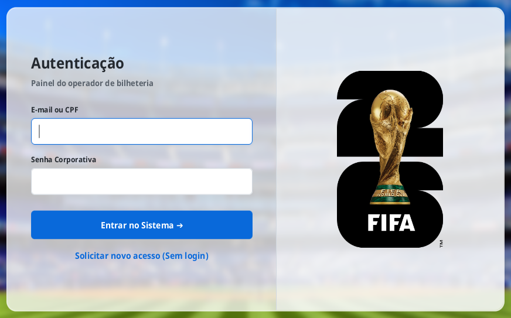
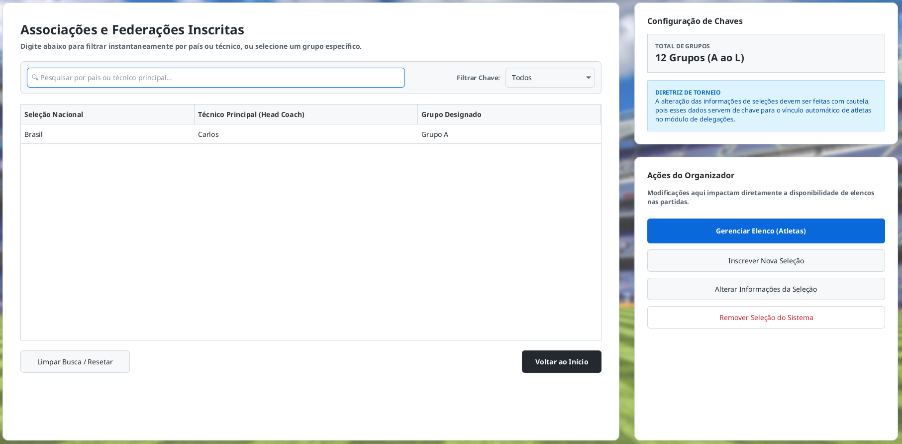
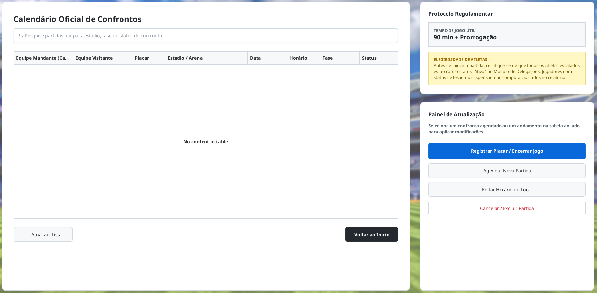
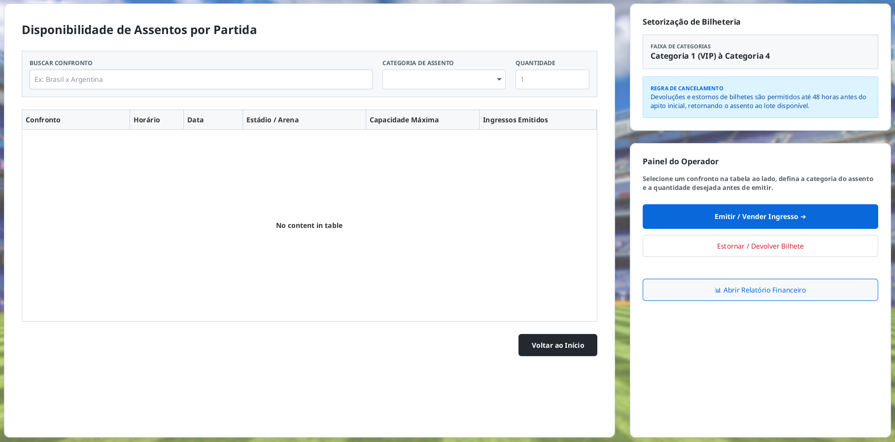

# ⚽ Gestão Copa 2026

Sistema de gestão da Copa do Mundo 2026 desenvolvido em **Java** com Programação Orientada a Objetos, para a disciplina **Técnicas de Programação 1 (CIC0197)** – UnB, Profa. Roberta Barbosa Oliveira (2025-2).

## 📌 Funcionalidades

- **Usuários e acesso:** login obrigatório, perfis (administrador, organizador, árbitro, operador) e relatórios gerais
- **Seleções e jogadores:** cadastro, edição, exclusão, consulta e controle de status (ativo, lesionado, suspenso)
- **Estádios e arbitragem:** cadastro de estádios e árbitros, designação para partidas
- **Partidas:** agendamento, fases da competição e registro de resultados
- **Ingressos e público:** venda por categoria, controle de capacidade e relatório de arrecadação

## 🖼️ Telas

| Login | Seleções |
|:---:|:---:|
|  |  |

| Partidas | Ingressos |
|:---:|:---:|
|  |  |

## 🛠️ Tecnologias

- Java (JDK 24 ou superior) · Maven
- JavaFX 21 com telas feitas no Scene Builder (FXML)
- AtlantaFX (tema da interface)
- Persistência em arquivos `.txt`
- Padrões de projeto: **Singleton** e **Builder**

## ▶️ Como executar

Pré-requisitos: **JDK 24+** e **Maven**.

```bash
git clone https://github.com/luviniu/Gestao-Copa-2026.git
cd Gestao-Copa-2026
mvn clean javafx:run
```

Ou abra o projeto no IntelliJ IDEA e execute a classe `Interface.Main`.
Execute sempre a partir da raiz do projeto, pois os arquivos `.txt` de dados ficam lá.

**Login inicial (teste):** `admin` / `admin`

## 🗂️ Estrutura

```
src/main/
├── java/
│   ├── Aplicacoes/   # lógica de aplicação
│   ├── Interface/    # telas e controladores JavaFX (Main)
│   └── Objetos/      # classes de domínio
└── resources/        # arquivos FXML
docs/                 # capturas de tela
*.txt                 # dados persistidos (usuários, seleções, jogadores, estádios, partidas, ingressos)
```

## 👥 Autores e Contribuições

Projeto desenvolvido em equipe para a disciplina de Técnicas de Programação 1:

| Integrante         | GitHub                                           | Principais Responsabilidades no Projeto                                                               |
| ------------------ | ------------------------------------------------ | ----------------------------------------------------------------------------------------------------- |
| **Luan Vinícius**  | [luviniu](https://github.com/luviniu)            | Administração e Gestão: gestão de usuários, autenticação, controle de acesso e relatórios gerais |
| **Renato Gabriel** | [Renato-Gab](https://github.com/Renato-Gab)      | Estádios e Arbitragem: gestão de estádios e árbitros                                              |
| **Elyel**          | [@elyeladht](https://github.com/elyeladht)       | Seleções e Jogadores: gestão de seleções e elenco de jogadores                                    |
| **Ahmed Faisal**   | [@Ahmed1878](https://github.com/Ahmed1878)       | Partidas: controle das partidas e resultados                                                      |
| **Saeed Issa**     | [@saeedissaUNB](https://github.com/saeedissaUNB) | Ingressos e Público: controle de ingressos e arrecadação                                          |
